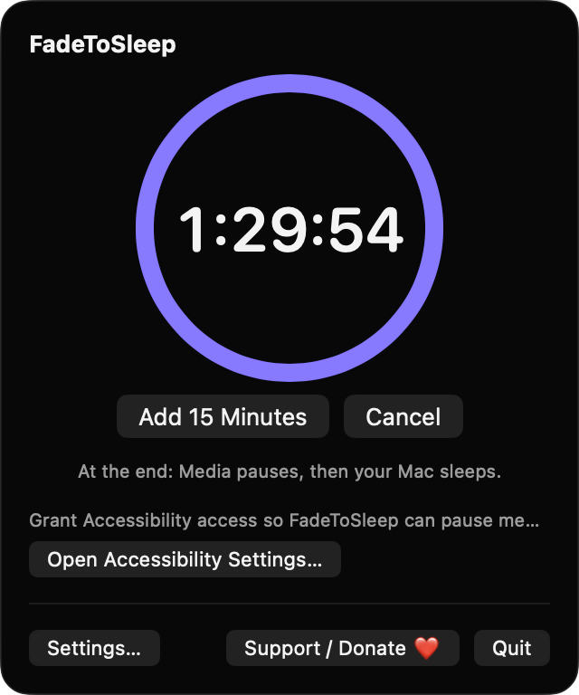
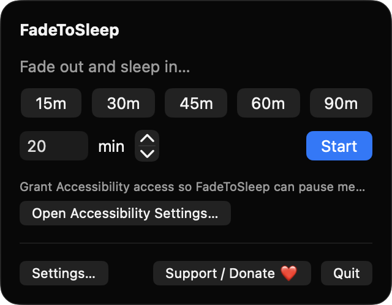
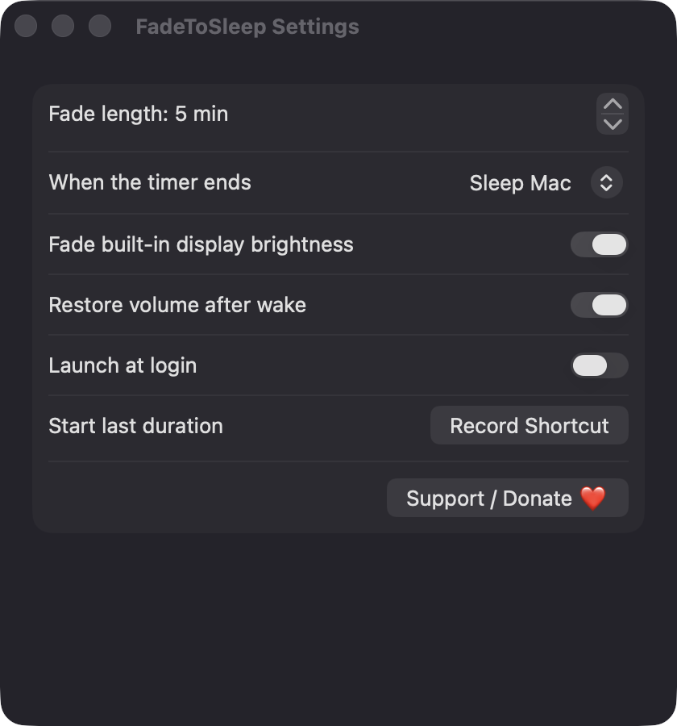

# FadeToSleep

**🌐 Website:** [turhe123.github.io/fade-to-sleep](https://turhe123.github.io/fade-to-sleep/)

Start a timer and your Mac's volume and screen glide down together before it pauses music and sleeps.


## Why

FadeToSleep is a free, open-source, 100% native, backend-free alternative to paid utilities in the *Audio* category. It was inspired by apps like Awaken ($6.99 one-time), which showed how useful a gentle sleep fade is for anyone who falls asleep to podcasts, rain noise or videos on a Mac. macOS has no built-in fade, so the Mac either plays all night or cuts out abruptly. FadeToSleep fills that gap with no accounts, no network access and no tracking.

## Features

- **Menu bar app** (`MenuBarExtra`, window style) with a moon icon; while a timer runs, the menu bar shows the remaining minutes.
- **Presets** of 15, 30, 45, 60 and 90 minutes, plus a custom minutes field and stepper (1–600).
- **Smooth fade**: output volume ramps linearly to zero over the final fade window (default 5 minutes, configurable 1–60), updated once per second.
- **Brightness fade** for the built-in display (optional; skipped silently if there isn't one).
- **End actions**: Sleep Mac, Sleep display only, or Do nothing but pause. At the end the app sends the system Play/Pause media key first.
- **Live countdown** with a progress ring, **Add 15 Minutes** and **Cancel** buttons, and a line describing what happens at the end.
- **Restore volume after wake** option so your morning isn't silent. Brightness is always restored.
- **Heads-up notification** one minute before the fade begins.
- **Global hotkey** you can record to start the last-used duration.
- **Launch at login** via `SMAppService`.
- **Safety behavior**:
  - If you change the volume yourself during a fade, fading pauses and the menu offers **Resume Fade**.
  - If the output device changes mid-fade, the ramp restarts from the new device's level.
  - If a device has no volume control, the menu says it can't be faded.
  - If the duration is shorter than the fade window, the window shrinks to fit.
  - If the Mac sleeps early or the lid closes, the timer is cancelled and state restored.
  - Volume and brightness are restored if you quit during a fade.
- Built with SwiftUI, AppKit, CoreAudio, IOKit, UserNotifications and ServiceManagement. No third-party packages.

## Screenshots

<p align="center"></p>

<p align="center"><em>A running sleep timer in the menu bar popover, with a progress ring counting down, Add 15 Minutes and Cancel buttons, and a note on what happens at the end.</em></p>

<p align="center"></p>

<p align="center"><em>The idle popover with one-click 15–90 minute presets and a custom minutes field to start a fade.</em></p>

<p align="center"></p>

<p align="center"><em>Settings for fade length, end action, brightness fade, volume restore, launch at login and a global shortcut.</em></p>

## Install

1. Download `FadeToSleep-macOS.zip` from the [latest release](https://github.com/turhe123/fade-to-sleep/releases/latest).
2. Unzip it and move `FadeToSleep.app` to `/Applications`.
3. Because the app is open source and not notarized, clear the quarantine flag:

   ```bash
   xattr -cr /Applications/FadeToSleep.app
   ```

4. The first time, right-click the app and choose **Open**.

## Build from source

Requires macOS 14+ and Xcode with Swift 5.9+.

```bash
brew install xcodegen
xcodegen generate
xcodebuild -project FadeToSleep.xcodeproj -scheme FadeToSleep -configuration Release -derivedDataPath ./build build
```

The app is produced at `build/Build/Products/Release/FadeToSleep.app`.

## Permissions

| Permission | Why |
| --- | --- |
| **Accessibility** | Needed to post the system Play/Pause media key that pauses your music or video at the end. The app prompts when you start a timer and links to the settings pane if it's missing. Without it, the fade and sleep still work but media isn't paused. |
| **Notifications** | Requested when the first timer starts, to warn you one minute before the fade begins. Optional. |
| **Login item** | Only if you enable "Launch at login" in Settings. |

FadeToSleep does **not** request Screen Recording or Microphone access, and it makes no network connections. Volume and brightness are controlled through Core Audio and IOKit directly.

## Support ❤️

If FadeToSleep helps you sleep better, you can support development:

[Support Or (Leo) Davidai ❤️](https://ko-fi.com/leodavidai)

## License

MIT © Or Davidai Bachar
